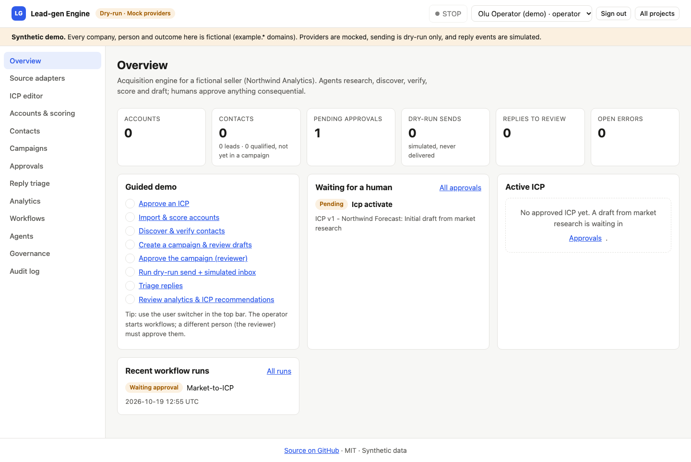

# Autonomous B2B Lead-gen Engine

An acquisition engine for **market research → ICP → account & contact discovery → verification → scoring →
approved campaigns → reply handling → performance feedback**, run by 20 specialised agents on a durable,
database-backed workflow engine, with every consequential step (approvals, sending, suppression, permissions)
enforced by deterministic code.

> **Synthetic demo.** All companies, people and outcomes are fictional (`example.com/.org/.net` domains,
> `+44 7700 900xxx` numbers). Providers are mocked by default, sending is **dry-run only** (there is no real email
> sender in this repository), and reply/delivery events are simulated. No paid API or credential is needed.



## What it does

| Workflow | Steps (agent or deterministic) |
|---|---|
| Market-to-ICP | market research → buyer personas → competitor gaps → ICP builder → **human approval** → activate |
| ICP-to-account list | approved-ICP check → permitted discovery (CSV, mock registry) → normalisation → **dedup** → public-page evidence → buying signals → **scoring** |
| Account-to-contact list | account selection → authorised contact discovery + buyer-role matching → enrichment → **verification** → leads → qualification → **suppression checks** → rescoring |
| Lead-to-campaign | segmentation & strategy → evidence-cited drafts → **policy checks** → **human approval** → send queue |
| Campaign-to-conversation | **dry-run dispatch** → simulated events (idempotent) → reply classification → **suppression** → **follow-up cancellation** → knowledge-grounded responses (cite / abstain / escalate) → mock CRM |
| Performance-to-improvement | analytics (tested formulas) → segment/source analysis → ICP recommendations → **human approval** → new ICP version |
| Governance sweep | workflow supervision (stale-step recovery, error queue, overdue approvals) → retention sweep |

**Agents** (each with Pydantic I/O, scoped tools, evidence, confidence threshold, retries and completion criteria):
Market & strategy — Market Research, ICP Builder, Buyer Persona, Competitor & Market Gap ·
Discovery & data — Account Discovery, Public Web Research, Contact Discovery, Data Enrichment, Contact Verification,
Lead Scoring, Buying Signal · Campaign & execution — Campaign Planning, Personalisation, Outreach Operations,
Inbox & Reply Classification, Follow-up · Measurement & governance — Performance Analytics, ICP Feedback,
Compliance & Data Governance, Workflow Supervisor.

## Quick start

Requirements: [uv](https://docs.astral.sh/uv/) (installs Python 3.12) and Node.js 20+ (22 recommended).

```bash
make dev                      # = ./scripts/dev.sh: venv, deps, migrate, seed, API :8000 + web :3000
```

* Windows: `powershell -ExecutionPolicy Bypass -File scripts\dev.ps1` (or use WSL and `make dev`).
* Ports fall back to 8100/3100 if 8000/3000 are busy; set `API_PORT` / `WEB_PORT` to choose.
* Clean start: `RESET_DB=1 make dev`. Pre-run the whole pipeline: `SEED_PROFILE=full make reset-db`.
* Docker: `docker compose up --build` (Postgres + API + web, migrations and seed on start; project name `leadgen`).
* Free hosted demo: see [docs/DEPLOY-VERCEL.md](docs/DEPLOY-VERCEL.md) (Vercel + Neon; documented, not yet deployed).

Open <http://localhost:3000> and sign in as **operator / demo**. Switch users from the top bar
(`admin`, `operator`, `reviewer`, `viewer`; password `demo` for all — demo auth only). Follow
[docs/DEMO.md](docs/DEMO.md) for the 10-minute walkthrough.

## Implementation status

| Area | Status | Notes |
|---|---|---|
| Workflow engine: runs/steps, idempotency keys, retries + backoff, error queue, pause/resume/cancel, leases, crash recovery, emergency stop | **Implemented & tested** | Request-driven ticks with a time budget; no background worker needed |
| Approval engine (no self-approval, four-eyes, agents can never decide) | **Implemented & tested** | `app/approvals.py` |
| Demo auth + RBAC (admin/operator/reviewer/viewer) | **Implemented & tested** | Demo only — see [SECURITY.md](docs/SECURITY.md) |
| Deterministic ICP scoring (8 weighted criteria, hard disqualifiers, missing data, evidence, model version) | **Implemented & tested** | Editable weights/tiers via versioned ICP drafts |
| Normalisation + dedup (domain / name+country keys, merge evidence) | **Implemented & tested** | |
| Email verification levels (syntax → MX → provider → delivery event → bounce) | **Implemented & tested** | DNS and provider are **mock**; deliverability only from (simulated) events |
| Suppression / opt-outs, frequency caps, follow-up cancellation | **Implemented & tested** | Checked at queue and send time |
| Campaign drafts with cited evidence + policy checks | **Implemented & tested** | Drafted by the mock LLM templates |
| Reply classification, escalation (pricing/legal), knowledge-grounded responses with citations / abstention | **Implemented & tested** | Mock LLM keyword classifier; approved synthetic knowledge passages |
| Metrics with formulas & denominators, segment/source breakdowns, ICP feedback → versioned update | **Implemented & tested** | Outcomes are simulated |
| Audit trail (agent actions, tool denials, approvals, sends, errors) | **Implemented & tested** | Append-only; demo reset is the only wipe and is audited |
| UI: sources, ICP editor, accounts/scoring, contacts, campaigns, approvals, reply triage, analytics, workflows, agents, governance, audit | **Implemented & tested** | Vitest unit tests + Playwright walkthrough (screens in `docs/screenshots/`) |
| CSV import adapter | **Implemented & tested** | Stored in DB, 2 MB limit |
| Companies registry API, licensed contact dataset, public web pages, DNS, mailbox verifier | **Mock only** | Fixture-backed adapters with real policy enforcement (allow/blocklists, robots, rate limits, cache) |
| Email sending, delivery/reply events, CRM | **Mock only** | Dry-run outbox, deterministic event simulator, `crm_outbox` table |
| LLM: Ollama, Anthropic (`LLM_PROVIDER`) | **Optional (needs local model / API key), untested** | Falls back to the mock on errors; never used for decisions |
| Real DNS MX lookups (`DNS_PROVIDER=dnspython`) | **Optional, untested** | |
| Docker Compose (Postgres) | **Implemented & verified** | Built, healthy, seeded, browser login checked, then torn down |
| Vercel serverless deployment | **Documented, verified locally only** | Entry point + e2e tested on Postgres with `VERCEL=1`; not deployed |
| Real email sending, real CRM/ESP integrations, production auth (OIDC), multi-tenancy | **Not implemented** | By design for the demo |

## Tests

* Backend: **50 pytest tests**, including one named test per brief acceptance criterion
  (`tests/test_acceptance.py`), a full API end-to-end run (`tests/test_e2e_api.py`), deterministic-core unit tests and
  engine/governance tests. The same e2e + acceptance tests also run through the Vercel entry point on PostgreSQL
  (`make e2e-postgres`, CI job `backend-postgres`).
* Frontend: TypeScript typecheck, ESLint (0 warnings), 8 Vitest unit tests, `next build`; a Playwright walkthrough of the whole flow (clean setup) produced `docs/screenshots/`.
* CI: [.github/workflows/ci.yml](.github/workflows/ci.yml) runs exactly these.

## Repository layout

```
backend/    FastAPI app (agents, workflows, adapters, deterministic core), Alembic, pytest, Vercel entry (api/index.py)
frontend/   Next.js App Router + TypeScript UI, Vitest
docs/       PLAN, ARCHITECTURE, DATA-SOURCES, SECURITY, RUNBOOK, DEMO, DEPLOY-VERCEL, screenshots/
scripts/    dev.sh / dev.ps1 one-command local run
```

Sample CSVs (synthetic) live in `backend/app/fixtures/samples/` and can be downloaded from the Source adapters page.

## Shared interfaces

`backend/app/schemas.py` is the canonical implementation of the shared shapes (Account, Contact, SourceRecord,
Evidence, QualificationResult, Lead, Approval, AuditEvent, Suppression) reused by `autonomous-b2b-revenue-ops`.
`GET /api/export/shared` exports them as JSON.

## Limitations

* All outcomes are simulated on synthetic data; numbers illustrate the mechanics, not real performance.
* The mock LLM is template/keyword based; real providers are optional and untested.
* Demo authentication with a shared password; tokens in `localStorage`; no CSRF/rate limiting on login.
* Single-tenant; no real sending, CRM, calendar or verification providers.
* The Vercel deployment is documented and locally verified but has not been run on Vercel.

## License

MIT © 2026 Dash-boop0 — see [LICENSE](LICENSE). Source: <https://github.com/Dash-boop0/autonomous-b2b-leadgen-engine>.
