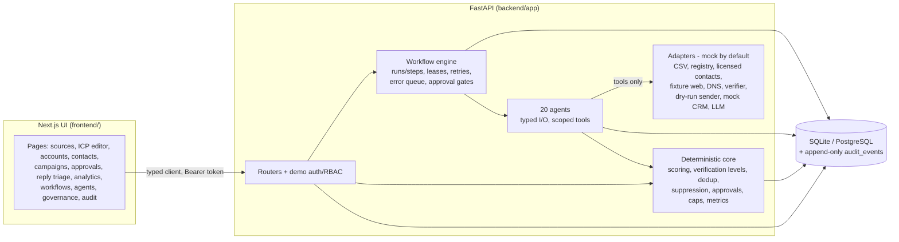
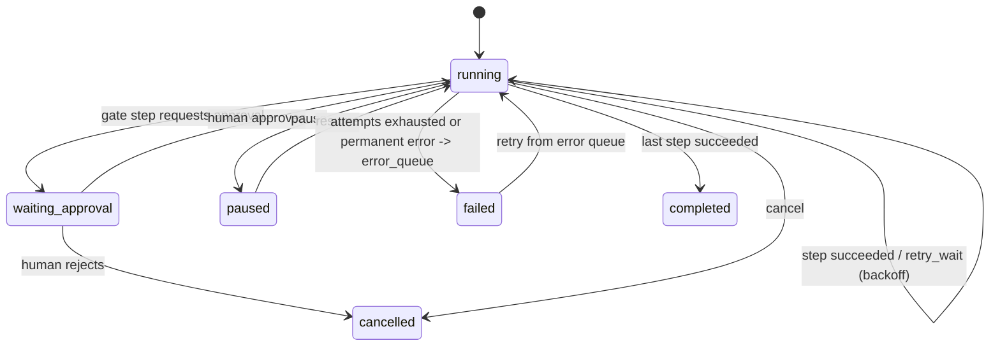
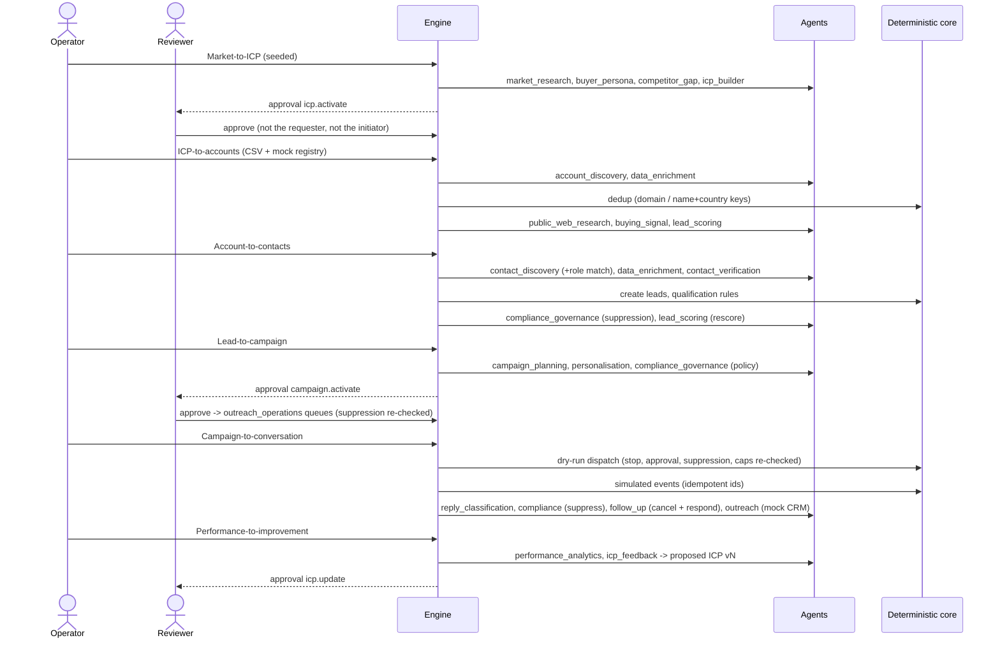

# Architecture

## Components

* **LLM use is narrow.** `LLMProvider` (default `MockLLM`, optional Ollama/Anthropic) only summarises research, writes
  score explanations, drafts emails/responses and classifies replies. Scores, verification levels, suppression,
  permissions, approvals, state transitions and frequency caps are plain Python with tests.
* **Agents** (`backend/app/agents`) subclass `BaseAgent`: Pydantic input/output models, a `tools` tuple (calling any
  other tool raises `ToolNotPermitted` and writes an audit event), `confidence_threshold` (below it the output is
  marked `needs_review` or `abstained`), in-agent retries for transient errors, `check_completion()` criteria
  (failure is permanent, sent to the error queue), and an audit event with evidence ids for every run.
* **Workflows** (`backend/app/workflows/definitions.py`) are code: ordered steps that call an agent, run deterministic
  code, or act as an approval gate.

## Workflow engine (request-driven, serverless-safe)

* `advance(run_id, budget)` executes steps until the run blocks (approval, backoff, pause, emergency stop) or the
  wall-clock budget (default 7 s) is spent. No background thread is needed; the UI and API calls drive it.
* A conditional `UPDATE ... WHERE lease_until < now` acquires a per-run lease, so concurrent requests never execute
  the same run. Each step commits its own transaction; a step left `running` by a crashed worker is retried once
  its lease expires (and the Workflow Supervisor agent resets stale steps).
* Retries use exponential backoff (`retry_base_seconds * 2^(attempt-1)`); permanent errors (`PermissionError`,
  `ApprovalError`, `AdapterError`, `AgentIncomplete`, `PermanentStepError`) skip retries.
* `start_run(..., idempotency_key)` returns the existing run for a repeated key; send-queue items, events, drafts,
  CRM updates and source records all have unique idempotency keys.
* The global emergency stop (system_state row) halts ticks, queueing and dispatch.

## The vertical path

## Data model (main tables)

`accounts`, `contacts`, `leads`, `qualification_results`, `evidence`, `source_records`, `suppressions`,
`approvals`, `audit_events` follow `_shared/SHARED-INTERFACES.md` field names (see `backend/app/schemas.py`).
Leadgen-specific: `icp_versions`, `offers`, `research_artifacts`, `campaigns`, `drafts`, `send_queue`,
`message_events`, `replies`, `crm_outbox`, `knowledge_passages`, `csv_uploads`, `source_adapters`,
`adapter_usage`, `fetch_cache`, `workflow_runs`, `workflow_steps`, `error_queue`, `system_state`, `users`.
Migrations: Alembic (`backend/alembic/versions/0001_initial_schema.py`).

## Deployment shapes

* Local: SQLite file in `backend/data/`, `scripts/dev.sh`.
* Docker Compose (`name: leadgen`): Postgres 16 + API + web (Next standalone).
* Vercel: two projects (API as a Python function with `backend/api/index.py`, web as Next.js) + Neon Postgres.
  See [DEPLOY-VERCEL.md](DEPLOY-VERCEL.md). The first request runs migrations and seeds if empty under a Postgres
  advisory lock (verified with 4 concurrent cold starts: exactly one seeded).
